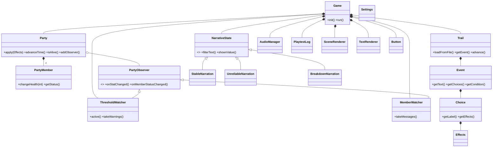

# The Scarygon Trail

An amusing survival horror game that has been influenced by William’s *Oregon Trail*; developed in C++ utilizing the SDL3 system for COMP3016 (Immersive Game Technologies) coursework 1.

At every point along the route, there are brief narrative events in a monotonous delivery, regardless of the event, whether it involves a broken wagon wheel or something of that sort. It challenges players to keep a family of four alive by managing their food, health, sanity, and wagon condition, and to experience the consequences of their actions.

**Repository:** https://github.com/AlexanderTovar765/ARTComp3016-Scarygon-Trail-
**Video (unlisted YouTube, max 10 minutes):** PLACEHOLDER: add the YouTube link

## Contents
1. [How to run](#1-how-to-run)
2. [Proposal and deviations](#2-proposal-and-deviations)
3. [Gameplay description](#3-gameplay-description)
4. [Sample screens](#4-sample-screens)
5. [Dependencies](#5-dependencies)
6. [Use of AI](#6-use-of-ai)
7. [AI Development Log](#7-ai-development-log)
8. [Game programming patterns](#8-game-programming-patterns)
9. [Game mechanics and how they are coded](#9-game-mechanics-and-how-they-are-coded)
10. [UML design diagram](#10-uml-design-diagram)
11. [Exception handling and test cases](#11-exception-handling-and-test-cases)
12. [Playtesting evidence and reflection](#12-playtesting-evidence-and-reflection)
13. [Further details](#13-further-details)
14. [Evaluation](#14-evaluation)

## 1. How to run

**From the submitted zip (no Visual Studio needed, Windows x64):** unzip, open the folder, and run `ScarygonTrail.exe` from inside it. The executable needs `SDL3.dll`, the irrKlang DLLs, the `data/` folder and the `assets/audio/` folder beside it, and the zip includes all of them.

**From source:** requires Visual Studio 2022 with the "Desktop development with C++" workload. SDL3 (3.4.18, x64) is bundled in `vendored/SDL3`, so no separate install is needed.

1. Open `ScarygonTrail.sln`.
2. Select `Debug | x64` (or `Release | x64`).
3. Press F5 to build and run. `SDL3.dll`, `data/` and `assets/audio/` are copied next to the executable automatically; output goes to `build/`.

**Sound (optional).** irrKlang's licence allows its DLL to be redistributed with a non-commercial program but not the whole SDK, so the SDK is not in the repository. To build with sound, run once from the repository root:

```
powershell -ExecutionPolicy Bypass -File tools\get-irrklang.ps1
```

then rebuild with **Build > Rebuild Solution**. The project detects `vendored/irrKlang` and links it. Without it the title screen says "Sound: unavailable" and the game is silent.

**Controls**
- Mouse click or `1`-`4`: pick a choice
- `M`: mute or unmute sound
- `L` (title screen): turn the anonymous playtest log on or off
- `Esc`: quit

## 2. Proposal and deviations

Week 2 proposal: https://docs.google.com/document/d/1e3urBafL8XUcumxg3YoX4mpzwOVRAyJINFEv5XdRE8o/edit?tab=t.0#heading=h.hbigc4tx4p9x

### Deviations from the proposal

| Proposal said | What was built | Justification |
|---|---|---|
| A long trail with `TrailNode` objects | 3 days x 5 parts; `Trail` stores events by (day, part) | CW1 is 30% of the module, so the content was scaled. A map keyed by slot was simpler than linked nodes |
| Party members that can be sick, cursed, lost or dead | Healthy, Ill or Dead | "Cursed" was cut for scope. Individuality comes from frailty and choices that target one member |
| Scrolling text in the bottom panel | Wrapped text that fits the panel, checked on load | Scrolling added little for short events, and fit is tested |
| ChatGPT as the AI tool | Claude | PLACEHOLDER: say why you used Claude instead |
| irrKlang to be requested if pursued | irrKlang used for sound | irrKlang is listed as permitted in the brief; it is optional at build time |
| PLACEHOLDER: any other change, especially ones driven by playtesting | | |

## 3. Gameplay description

Three playable days. Each day has 5 parts (Dawn, Mid-Morning, Noon, Evening, Night), one event per part, and four choices per event. There are 20 events in total: 15 normal events plus 5 "desperate" variants that replace a normal event when the party is in trouble. Events are loaded from `data/events.txt`.

- **A family of four** (Ma, Pa, Junior, Granny) with portraits in the top panel. Each has their own health and can fall ill or die, and some choices hit one person only. The Health bar is the family average, and the dead count as 0.
- **Resources:** Food, Health, Sanity and Wagon, shown as bars. The trail takes a toll after every part.
- **Sanity changes how trustworthy the game is:** Stable above 60, Unreliable from 30 to 59 (some words and HUD numbers are wrong), Breakdown below 30 (numbers hidden, lies freely). Only the presentation lies. What choices do, and the "what happened" summary, are always true.
- **Desperate events:** when food, the wagon or health drops into danger, a warning appears and a harsher version of a later event can replace the normal one.
- **Screens:** title, how to play, events, results, day summaries and an ending summary showing who survived and how far the family got.
- **Sound:** ambience that follows the narrator state, plus effects for choices, warnings and deaths.
- **Ending:** the run ends if the whole family dies, or Sanity or the Wagon reaches 0, or the three days are completed.

PLACEHOLDER: add a paragraph in your own words about what a run feels like and what makes it unique.

## 4. Sample screens

| Title | How to play |
|---|---|
| () |() |

| An event | A result with a warning |
|---|---|
| () |() |

| Ending summary |
|---|
| () |


## 5. Dependencies

- **SDL3 3.4.18** (bundled in `vendored/SDL3`): window, rendering, input and the built-in debug font.
- **irrKlang 1.6.0** (optional, downloaded by `tools/get-irrklang.ps1`): sound.
- Nothing else beyond the standard C++17 library.

## 6. Use of AI-COME BACK TO

PLACEHOLDER: two or three paragraphs in your own words: which tool you used, what for, what you reviewed and changed, and what you decided yourself.

The full account is in the AI Development Log (section 7). The signed Generative AI Declaration is included as an appendix: PLACEHOLDER: link or attach the signed form.

## 7. AI Development Log

See [docs/ai-dev-log.md](docs/ai-dev-log.md) for the AI tools used, categories of use, example prompts, the verification process, and repository evidence.

## 8. Game programming patterns-ASK CLAUDE FOR PLACEHOLDER

| Pattern | Where | Why |
|---|---|---|
| Game Loop | `Game::run`: handle input, update, render each frame | Standard structure for a real-time window |
| State | `NarrativeState` with `StableNarration`, `UnreliableNarration` and `BreakdownNarration` (in `NarrativeState.cpp`) | Sanity changes how trustworthy the presentation is. `Game` swaps one object and calls the same functions |
| Observer | `PartyObserver`, `ThresholdWatcher`, `MemberWatcher` | `Party` announces changes without knowing who is listening, so warnings and illness messages are decoupled from the rules |
| Composition | `Party` owns four `PartyMember` objects | The party is made of its members, and health is derived from them |
| Data-driven content | `Trail::loadFromFile` reads `data/events.txt` | Events can be written and edited without recompiling |
| Pimpl idiom | `AudioManager::Impl` | Keeps irrKlang out of the header. The same class is a silent stand-in when irrKlang is not built in |

The game’s central joke is that the narrator gets less trustworthy as sanity drops. The State pattern lets Game swap one narrator object (Stable, Unreliable or Breakdown) without any if chains, and it keeps the lying confined to the presentation, so the rules stay fair. The Observer pattern suits a game where the family’s condition keeps changing, because Party can announce a low-food warning or a death without knowing who is listening, so new reactions can be added without touching the party’s rules.

## 9. Game mechanics and how they are coded

| Mechanic | How it works | Code |
|---|---|---|
| Day and part progression | `Trail` tracks the current day and part; 15 parts in total, then the trail ends | `Trail::advance`, `Trail::getEvent` |
| Choices and effects | Each choice carries `Effects` (food, health, sanity, wagon and an optional member). `Party::apply` applies them, clamped to 0-100 | `Effects`, `Party::apply` |
| The trail's toll | After every part the party eats, sanity and the wagon wear, every living member loses health (scaled by frailty), and starvation hurts at 0 food | `Party::advanceTime` |
| Individual members | Health out of 100 and a frailty percentage; Ill below 40, Dead at 0; each death costs the survivors sanity | `PartyMember`, `Party::applyGrief` |
| Targeted choices | A choice with `member = Pa` hits only that member | `Effects::member` |
| Desperate events | An event with `requires = LowFood` replaces the normal event while that condition is active | `ThresholdWatcher`, `Trail::getEvent` |
| Unreliable narration | Text swaps and HUD jitter depend on a per-screen seed, so nothing flickers. The "what happened" line is always true | `NarrativeState`, `Game::onEventChoice` |
| Sound | Ambience follows the narrator state; effects play for choices, warnings and deaths | `AudioManager` |
| Playtest log | Optional anonymous CSV of the choices made | `PlaytestLog`, `Settings` |

## 10. UML design diagram
New Design:


Old Design: 
  

## 11. Exception handling and test cases

The code does not use C++ exceptions. Instead it validates input and reports problems, so bad data cannot crash the game:

- **Event file:** a missing or empty file shows a clear message. A malformed event is skipped with a warning that names the line. Text and numbers are cleaned (byte-order marks, Windows line endings and curly quotes are handled, and out-of-range effects are clamped).
- **Settings file:** a missing file is fine. Bad lines are reported and defaults are used.
- **Audio:** missing irrKlang, no sound device, or a missing sound file never stops the game.
- **Playtest log:** if the log file cannot be created, logging is switched off quietly.
- **Input:** keys that match no button are ignored.

**Tests:** `tests/logic_tests.cpp` has 25 test groups (14,202 checks), all passing, with the silent audio stub and with the real irrKlang engine. Details are in [docs/test-cases.md](docs/test-cases.md). The balance simulation (20,000 games per strategy) is in [docs/balance-report.md](docs/balance-report.md).

To run the tests (from the repository root, because they read `data/` and `assets/audio/`):

```
cmake --build build --target logic_tests
ctest --test-dir build --output-on-failure
```

## 12. Playtesting evidence and reflection-COME BACK TO

Evidence (session log, observation notes, questionnaire results) is in [docs/playtesting.md](docs/playtesting.md). PLACEHOLDER: link the playtest folder (for example `docs/playtest/`) once it is in the repository, and link the GitHub Issues that came from tester feedback.

### Playtesting reflection-COME BACK TO

- **Who participated:** PLACEHOLDER: number of testers, who they were (anonymised) and when.
- **What was tested:** PLACEHOLDER
- **Feedback received:** PLACEHOLDER: the main themes.
- **Changes implemented:** PLACEHOLDER: each change with its issue number and commit.
- **Remaining limitations:** PLACEHOLDER

## 13. Further details

- **Project structure**

```
src/      C++ source (Game, Party, PartyMember, observers, Trail, NarrativeState, renderers, audio, settings, playtest log)
tests/    logic_tests.cpp, automated tests
tools/    balance_sim.cpp (plays thousands of games to check difficulty), make_sounds.py (synthesises the sounds), get-irrklang.ps1
vendored/ bundled SDL3 headers and x64 libraries (irrKlang is downloaded here by the script, not committed)
assets/   audio/ (generated WAV files)
data/     events.txt (loaded at runtime, format explained at the top of the file) and settings.txt
docs/     AI Development Log, balance report, test cases, playtesting
```

- **Anonymous playtest log:** off by default. It can be turned on in `data/settings.txt` or with `L` on the title screen. It records the choices made and the result, with no names or personal data.
- **Git evidence:** PLACEHOLDER: add a screenshot of your GitHub Insights contribution graph and of key milestone commits.

## 14. Evaluation-COME BACK TO

PLACEHOLDER: a brief evaluation in your own words: what you achieved, what you would do differently knowing what you know now, and what you are proudest of. Points to consider: what playtesting taught you, how heavy AI use changed your role, and what you would add with more time.
